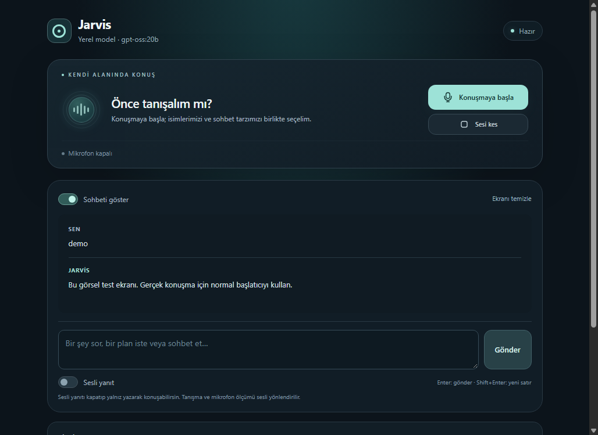

# JarvisVoice — 0.3.0

**Türkçe konuş, aynı pencerede yazış, kişisel notlarını hatırlat ve bir sonraki adımını planla.**

JarvisVoice, Windows üzerinde çalışan yerel bir masaüstü yardımcısıdır. Kendi penceresi, sohbet kutusu, mikrofonu ve Türkçe sesi vardır. Yanıtları bu bilgisayardaki **Ollama + gpt-oss:20b** üretir; ses için **Whisper small + EMA Lightning** kullanılır.

[**0.3.0 Windows paketini indir**](https://github.com/MchtMzffr/JarvisVoice/releases/download/v0.3.0/JarvisVoice-0.3.0-Windows.zip) · [Sürüm notları](https://github.com/MchtMzffr/JarvisVoice/releases/tag/v0.3.0) · [Güncel kaynak ZIP](https://github.com/MchtMzffr/JarvisVoice/archive/refs/heads/main.zip) · [Kurulum](#ilk-kurulum) · [Doğrulama](docs/VALIDATION.md) · [Gelişim sırası](docs/ROADMAP.md)

> Deneysel 0.x sürümü. Windows masaüstü kabuğu, sohbet, plan ve uygulama komutları aynı projede bulunur. Yapılan testler ve henüz kullanıcı donanımında doğrulanmayan yollar [doğrulama kaydında](docs/VALIDATION.md) ayrılır.



*Gerçek Windows WebView2 penceresinden alınmıştır. CI demo modu gösterilir; ekrandaki örnek yanıt GPT-OSS tarafından üretilmemiştir.*

## Neler yapar?

| İhtiyaç | Davranış |
|---|---|
| Konuşmak veya yazışmak | Aynı sohbet kutusunda metin ve ses. **Sesli yanıt** kapatıldığında normal yanıt metin olarak gelir. |
| Seni tanımak | İsim ve konuşma tercihleri onaylı profilden, kişisel bilgiler açıkça kaydettiğin notlardan gelir. |
| Plan hazırlamak | Hedefinden en fazla 6 adımlı taslak üretir; **Planı kaydet** isteğinle bu bilgisayara kaydeder. |
| Uygulama açmak | Oturum izni açıkken Hesap Makinesi, Not Defteri, Dosya Gezgini ve Paint için doğrudan komut alır. |
| Güncel bilgi araştırmak | İsteğe bağlı internet araması ve kaynak bağlantıları; yerel sohbet için anahtar gerekmez. |
| Mikrofonu ayarlamak | Sesli tanışma ve kısa mikrofon ölçümü; beğenilen Türkçe EMA sesi korunur. |

## İlk kurulum

Hedef platform **Windows x64**. Geliştirme hedefi 32 GB RAM ve 16 GB VRAM sınıfındaki bir bilgisayardır; daha düşük donanımdaki hız ayrıca ölçülmelidir. İlk kurulum internet gerektirir. Mevcut model yoksa yaklaşık **13 GB GPT-OSS**, yaklaşık **525 MB ses dosyası** ve Python/masaüstü paketleri indirilir; model, paket ve önbellekler için ek disk alanı gerekir.

1. Yukarıdaki ZIP'i kalıcı bir klasöre **tümüyle çıkar** veya depoyu Git ile klonla.
2. **KUR.cmd** dosyasını aç. Uygulamaya özel Python ve sabit paketler hazırlanır. Windows WebView2 ve Ollama eksikse `winget` üzerinden kurulur; `gpt-oss:20b` eksikse yerel Ollama'ya indirilir.
3. Kurulum başarıyla tamamlandığında **BASLAT.cmd** dosyasını aç.
4. **JarvisVoice'un kendi masaüstü penceresi** açılır. Sohbet kutusuna yaz veya **Konuşmaya başla** düğmesine bas.

Mevcut Ollama/model kurulumu yeniden indirilmez. Kurulum `winget` bulamazsa resmî Ollama/WebView2 bağlantılarını gösterip durur. İlk indirmeden sonra yerel sohbet ve ses dosyaları yerel çalışır; isteğe bağlı internet araştırması ayrı açılır. Ollama'nın kendi Chat ekranına Jarvis özelliği eklenmez: JarvisVoice, Ollama'nın [yerel API'sini](https://docs.ollama.com/api/introduction) kullanan masaüstü uygulamasıdır.

## Çalışan eski kurulumu 0.3.0'a güncelleme

1. Açık Jarvis penceresini ve eski Jarvis terminalini kapat.
2. Yeni kaynağı eski kurulumdan ayrı bir klasöre al.
3. Yeni kaynak klasöründeki **GUNCELLE.cmd** dosyasını aç; seçicide eski çalışan kurulumun **BASLAT.cmd** dosyasını seç.
4. Kod yedeği ve aktarımı bittikten sonra güncelleyici eski klasördeki **KUR.cmd** kontrolünü çalıştırır. Bu adım yeni masaüstü paketlerini kurabilir; internet gerekir. Mevcut modeller ve kullanıcı verileri korunur.
5. Bütün adımlar başarıyla bitince eski klasördeki **BASLAT.cmd** ile devam et.

0.1.0 / 0.2.0 / 0.2.1 / 0.3.0 kurulumları desteklenir. Kod aktarımı ve Python paket kurulumu ayrı işlemlerdir: paket kurulumu başarısızsa eski klasörde **KUR.cmd** yeniden çalıştırılır. Kod güncelleyicisi paket kurulumunu geri aldığını iddia etmez. Port durumu bilinmiyorsa kod aktarımı başlamaz. [Geçiş ve geri alma sınırları](docs/COMPATIBILITY.md).

### Git ile kaynak güncelleme

Git kurulduktan sonra ilk kaynak kopyası:

```powershell
cd $env:USERPROFILE
git clone https://github.com/MchtMzffr/JarvisVoice.git JarvisVoice-Kaynak
```

**Kaynak klonu ve çalışan eski kurulum ayrı klasörlerdeyse**, sonraki güncellemelerde:

```powershell
cd "$env:USERPROFILE\JarvisVoice-Kaynak"
git pull --ff-only
if ($LASTEXITCODE -eq 0) { .\GUNCELLE.cmd }
```

**İlk kurulumu doğrudan Git klonunda yaptıysan**, Jarvis'i kapat; o klasörde `git pull --ff-only` başarılı olduktan sonra `KUR.cmd`, ardından `BASLAT.cmd` çalıştır. Güncelleyicide kaynak klasörünü hedef olarak seçme. Git ile alınmayan ZIP klasörü `git pull` kullanamaz.

## Kişisel not, uygulama ve plan örnekleri

Sesle veya sohbet kutusuyla:

- **“Bunu hatırla: Hafta içi akşamları yarım saat ayırabiliyorum.”** Açık isteğinle kalıcı not olur.
- **“Neleri hatırlıyorsun?”** Kaydettiğin notları gösterir/söyler.
- **“Hesap makinesini aç.”** Önce Ayarlar → **Bilgisayarda uygulama açma** iznini aç. İzin her oturumda kapalı başlar.
- **“Jarvis, not defterini açar mısın?”** Aynı izinli uygulama yönlendiricisini kullanır.
- **“Plan oluştur: Akşamları yarım saat ayırarak Python öğrenmek istiyorum.”** Profil ve notlarla yerel modelde taslak üretir.
- **“Planı kaydet.”** Ekrandaki taslağı bu bilgisayara kaydeder; varsa önceki kayıtlı planın yerini alır.
- **“Planımı göster.”** Önce güncel taslağı, taslak yoksa kayıtlı planı açar/okur.
- **“Plan taslağını iptal et.”** Kaydedilmemiş taslağı kaldırır.
- **“Kayıtlı planımı sil.”** Kayıtlı planı siler.

Plan taslağı kaydedilene kadar RAM'dedir ve 10 dakika sonra geçersizleşir. Bu sürüm tek kayıtlı plan tutar; plan adımlarını otomatik yürütmez, takvime eklemez veya hatırlatıcı başlatmaz. Uygulama komutları dört sabit uygulamayla sınırlıdır; serbest PowerShell/terminal komutu, modelin ürettiği dosya yolu veya web metninden uygulama başlatılmaz. “Başlatma isteği gönderildi” işletim sistemine isteğin iletildiğini belirtir; pencerenin gerçekten görünmesini ölçmez.

## İlk konuşma: sesli tanışma

İlk başlangıçta Jarvis sırasıyla şunları sorar:

- Sana nasıl hitap edeceği.
- Kendisine hangi ismi vereceğin.
- Samimi, dengeli veya resmî konuşma tercihin.
- Kısa, orta veya ayrıntılı yanıt tercihin.
- Sözünü bitirmen için kısa, dengeli veya rahat bekleme süresi.
- Kulaklık mı hoparlör mü kullandığın.

Örneğin “Adım Muzaffer”, “Sana Atlas diyeyim”, “Samimi konuş”, “Kısa cevap ver” diyebilirsin. Sonunda tercihleri okuyup onay ister; **son onaydan önce profil dosyası yazılmaz**. “Tekrar”, “iptal” veya “baştan başla” diyebilirsin. Mikrofonu kapatıp aynı oturumda açınca yarım kalan adıma dönülür; pencereyi kapatmak kaydedilmemiş taslağı siler.

Yeniden değiştirmek için **“Yeniden tanışalım”** de veya **Tanışma ve sana göre ayarlar** bölümünü aç. Formdaki değişiklikler yalnız **Tercihleri kaydet** düğmesiyle uygulanır. Bu sürüm tek yerel profil kullanır; sesinden kim olduğunu tanımaz ve farklı kişileri otomatik ayırmaz.

Duraklama tercihleri 16 kHz / 512 örnek kareleri üzerinden yaklaşık **544 / 800 / 1216 ms** sessizlik bekler. Bunlar toplam yanıt gecikmesi değildir. Daha kısa bekleme, doğal duraksamalarını sözün bitişi sanma riskini artırır. Kulaklık tercihi sesli araya girmeyi kendiliğinden açmaz.

## Mikrofonu birlikte ayarlama

**“Mikrofonu ölç”** de veya aynı adlı düğmeye bas:

1. Jarvis yönergesini tamamen bitirir.
2. Yaklaşık üç saniye sessiz kalmanı ister; ortamın dijital ses seviyesini ve VAD davranışını ölçer.
3. Şu cümleyi söylemeni ister: “Bugün seninle sakin ve doğal bir şekilde konuşmak istiyorum.”
4. Duyulan cümleyi, kelime farkını, yaklaşık konuşma/ortam seviye farkını ve kırpılmayı gösterir.
5. Kontrol uygunsa **Mikrofon ayarını uygula** seçeneği görünür. Aynı ifadeyi sesle de söyleyebilirsin.

Bu işlem model eğitimi, ses kimliği kaydı veya duygu kalibrasyonu değildir. Tarayıcı işleme etkileri altında kısa bir mikrofon kontrolüdür. Kalıcı olarak yalnız sınırlandırılmış VAD eşiği saklanır. Ham ses ve örnek cümle diske yazılmaz. Kötü örnekte ayar uygulanmaz; mikrofon mesafesini/giriş seviyesini düzeltip tekrar dene.

## İsteğe bağlı ses özellikleri

**Ayarlar → Ses özelliklerini incele (deneysel)** varsayılan olarak kapalıdır. Açınca, tamamladığın her normal sesli tur için yerel Python şu ölçümleri üretir:

| Ölçüm | Ne anlatır? |
|---|---|
| Süre, RMS/tepe dBFS | Tarayıcının işlemiş olduğu dijital ses; fiziksel desibel/SPL değildir. |
| Kırpılma yüzdesi | Tam dijital ölçeğe yaklaşan örneklerin oranı. |
| Konuşma/duraklama oranı | VAD karelerinden yaklaşık oran; dilbilimsel duraklama etiketi değildir. |
| Kelime/dakika | ASR'nin tanıdığı kelimeler / duraklamalar dâhil kayıt süresi; ASR hatasından etkilenir. |
| Temel frekans medyanı/aralığı | Yeterli periyodiklik bulunan karelerde yaklaşık F0; uygun sinyal yoksa değer üretilmez. |
| Mikrofon işleme ayarları | Gerçek `getSettings()` çıktısından örnekleme, kanal, yankı/gürültü giderme ve otomatik kazanç bilgisi. |

Ölçümler yerel modele metin olarak aktarılabilir; GPT-OSS ses dalgasını doğrudan duymaz. Bu değerlerden “öfkelisin”, “utandın”, “hastasın” gibi sonuçlar çıkarmaması istenir. **İstem kuralı, modelin her yanıtının doğru veya güvenli olacağını matematiksel olarak garanti etmez.** Duygu sınıflandırma başarısı iddia edilmez.

Ölçümler normal sohbet sırasında RAM'dedir; ayrı dosyaya/loga yazılmaz ve profilin parçası yapılmaz. Kapatınca önceki tur iptal edilir; gecikmiş ölçüm yeni yanıta taşınmaz. Tanışma ve mikrofon kontrolü zaten bu analizi kullanmadığından kapatma bu rehberleri kesmez. Bağlantı yeniden kurulunca seçenek kapalı başlar. Aygıt kimliği, grup kimliği ve cihaz etiketi alınan ölçüm sözleşmesine konmaz.

İnternet açıkken arama kararı ses ölçümü nesnesini almaz. Ölçüm gerekiyorsa araçsız ayrı bir yerel yanıt çağrısı yapılır; arama gerekmeyen turda bile bu **ek gecikme** yaratabilir. Arama servisine gönderilen sorgu yine model tarafından üretilir; konuşma içeriğindeki kişisel bilgilerin hiçbir koşulda sorguya girmeyeceği garanti edilmez. İnternet kapalıyken bu ek araç-kararı çağrısı yoktur.

## Günlük sohbet

- **Mikrofonu kapat:** mikrofon akışını ve o anki yanıtı durdurur.
- **Sesi kes:** yanıtı keser; mikrofon açıksa dinleme sürer.
- **Sohbet kutusu:** konuşma ve yazışma metinleri açılışta görünür; kaynaklar ayrıca gösterilir.
- **Yazılı sohbet:** mikrofon kullanmadan aynı yerel modele ulaşır. Sesli yanıt kapalıysa normal cevapta TTS çağrılmaz; tanışma ve mikrofon yönergeleri sesli kalır.
- **Son yanıtın süreleri:** ASR, model ilk metni, ilk ses hazırlığı ve TTS gerçek zaman oranını gösterir.

Varsayılan olarak Jarvis konuşurken mikrofon aktarımı duraklar. Kulaklıkla **Konuşurken de beni dinle** seçeneğini açabilirsin. Hoparlör yankısı tarayıcı/cihaz düzenine bağlıdır. Tek konuşma yaklaşık **30 saniye** ile sınırlıdır; sınır dolarsa eksik düşünceye cevap üretmek yerine mikrofon durur. Bu sürüm kısmi metni konuşurken akıtan bir ASR kullanmaz.

## İnternet araştırması ve hafıza

Yerel sohbet için API anahtarı gerekmez. İnternet araştırması için [Ollama anahtar sayfasından](https://ollama.com/settings/keys) bir anahtar oluşturup uygulamadaki parola alanıyla bağla; ardından **Güncel bilgi için internete bak** seçeneğini aç. Güncel kota ve koşullar servise aittir: [resmî belge](https://docs.ollama.com/capabilities/web-search).

Anahtar yalnız oturum RAM'inde tutulur; giriş alanı temizlenir, dosyaya veya tarayıcı depolamasına yazılmaz. Her tur en fazla bir arama ve iki sayfa getirme yapılır. Sorgular ve URL'ler Ollama'nın internet servisine gider; yanıt modeli yerel kalır. Kaynak göstermek, her cümleyi otomatik doğrulamış olmak değildir. Bu ortamda canlı web anahtarıyla uçtan uca test yapılmadı.

Kalıcı kısa notlar yalnız doğrudan kullanıcı komutuyla kaydedilir:

- “Bunu hatırla: Yürüyüş yapmayı severim.”
- “Neleri hatırlıyorsun?”
- “Tüm hatıralarımı sil.”

Profil `data/profile.json`, mikrofon eşiği `data/audio_calibration.json`, açıkça kaydedilmiş notlar `data/memories.sqlite3`, açıkça kaydedilmiş tek plan `data/plan.json` içindedir. Bu dosyalar şifrelenmiş değildir. Son komut yalnız hatıraları siler; profil ve mikrofon ayarları ayrı tutulur. Normal sohbet, ses ve ölçümler kalıcı kayda alınmaz. Model bir ölçümü sözlü yanıtta açıklarsa o metin normal oturum geçmişinde bulunabilir. 4096 token bağlam doldukça eski turlar düşürülür; sesli modda yalnız tamamen oynatılan yanıt cümleleri, sessiz yazışmada yalnız tamamlanıp gönderilen yanıt geçmişe işlenir.

## Mimari ve performans kararı

| İş | Bileşen / yer |
|---|---|
| Yanıt | Mevcut gpt-oss:20b, think=low, ctx4096 / yerel Ollama |
| Konuşma sınırı | Silero V6 / CPU |
| Türkçe ASR | Whisper small, CTranslate2 int8 / CPU |
| Ses üretimi | Aynı EMA Lightning 1.1.2 / CPU |
| Akustik ölçüm | NumPy, sınırlı kare analizi / ayrı CPU işi |
| Masaüstü arayüz | pywebview 6.2.1 + Microsoft WebView2; yerel WebAudio / 127.0.0.1:8765 |

Masaüstü pencere `pywebview`/WebView2 ile açılır. Arayüz ve Python sunucusu aynı uygulama tarafından başlatılır; pencere kapanınca Jarvis sunucusu kapanışa alınır. Mevcut Ollama servisi ortak yerel model motorudur ve kapatılmaz. [Masaüstü tasarımı](docs/DESKTOP_0_3.md).

0.2.0 mevcut modeli başlangıçta yüklemeyi dener, isteklerde `keep_alive=30m` kullanır, HTTP bağlantısını yeniden kullanır, sabit yönergelerin sesini RAM'de en fazla 24 giriş/8 MiB ile önbellekler ve isteğe bağlı ses analizini ASR ile paralel başlatır. Bunlar belirli bir Windows gecikmesi garanti etmez. Uzun `keep_alive` modelin bellekte daha uzun kalmasına yol açabilir. GPU/CPU ASR karşılaştırması ve gerçek mikrofon gecikmesi ayrıca ölçülmelidir.

## Gizlilik, sınırlar ve sorun giderme

Sunucu yalnız loopback üzerinde çalışır; WebSocket origin, rastgele açılış anahtarı, tek oturum ve protokol sürümü denetlenir. Yüksek hızda tur oluşumu sınırlandırılır. Ses/model işlerindeki iptal eski çıktıyı düşürür; başlamış native CPU hesabını zorla öldürdüğünü varsaymaz.

Ses modelleri normal çalıştırmada yerel dosyalardan açılır. ONNX Runtime telemetrisi native importtan önce `ORT_DISABLE_TELEMETRY=1` ile kapatılır; Hugging Face çevrimdışı/telemetri ayarları da uygulanır. Bu, Windows/tarayıcı/Ollama'nın bütün ağ trafiğinin sistem düzeyinde denetlendiği anlamına gelmez.

| Durum | İşlem |
|---|---|
| Model/bağlantı hatası | Ollama'yı aç; `ollama list` içinde gpt-oss:20b'yi kontrol et. |
| Eski arayüz / protokol uyuşmazlığı | Eski Jarvis penceresini kapat; güncellenmiş BASLAT.cmd ile aç. |
| Mikrofon reddedildi | Jarvis/WebView2 iznini ve Windows mikrofon gizlilik ayarını kontrol et. |
| Kendi sesine cevap veriyor | Kulaklık kullan; konuşurken dinleme seçeneğini kapat. |
| Kelimeler yanlış | Mikrofon kontrolünü çalıştır; ASR transkriptini incele. |
| Cümlem yarıda kesiliyor | Duraklamayı “Rahat” seç; bu toplam yanıt süresini uzatır. |
| Profil/kalibrasyon dosyası bozuk | Hata mesajındaki dosyayı yedekleyip kaldır; uygulama varsayılana döner. |
| 8765 portu dolu | Önceki Jarvis penceresini/terminalini kapat; başka süreci otomatik sonlandırmaz. |
| Masaüstü paketi / WebView2 eksik | KUR.cmd ile masaüstü bileşenlerini tamamla. |
| DLL yüklenmiyor | [Microsoft Visual C++ x64 Runtime](https://learn.microsoft.com/en-us/cpp/windows/latest-supported-vc-redist) gereksinimini kontrol et. |

### Güncelleme kurtarma

Güncelleme yazma hatasında otomatik geri alma sonucunu bildirir. İşlem zorla kapatılırsa veya elektrik kesilirse `backups/<zaman-kimlik>/manifest.json` ve `files/` kalır. Jarvis ve güncelleyici kapalıyken yedekteki eski dosyalar aynı göreli yollara geri konabilir. Yeni eklenen dosyalar ancak manifestte `old_sha256=null` olması ve mevcut SHA256 değerinin `new_sha256` ile eşleşmesi durumunda kaldırılmalıdır; kullanıcı değişikliklerini silme. `.jarvis-update.lock` dosyasını yalnız çalışan güncelleme olmadığını ve kodun tutarlı biçimde geri alındığını/güncellendiğini doğruladıktan sonra kaldır. Emin değilsen hata ve manifesti incelet; modeli/veri klasörünü silme.

## Kanıt ve geliştirme

`docs/VALIDATION.md` yapılan ve yapılamayan testleri; `docs/CONTRACT.md` protokol/invariantları; `docs/PARAMETER_INDEX.md` tek parametre kaynağını; `docs/COMPATIBILITY.md` sürüm ve şema uyumluluğunu açıklar. Kaynak kodları ve testler pakette bulunur.

```powershell
.\.venv\Scripts\python.exe -m unittest discover -s tests -v
```

Geliştirme için JavaScript testleri (kullanıcı kurulumunda Node gerekmez):

```text
node --test tests/test_frontend.js tests/test_resampler.js
```

Kullanıcı önceki sürümde konuşmanın iyi olduğunu ve kalibrasyonun olmuş göründüğünü bildirdi; bu, yeni masaüstü sürümünün uçtan uca kabulü değildir. Yeni sürümün gerçek model/mikrofon/Windows kabul durumu docs/VALIDATION.md içinde ayrı kaydedilir. Ses kontrolünde tek bir örnekte WER=0 veya çok sayıda geçen birim testi, genel Türkçe/duygu/klinik başarı oranı değildir.

## Geliştirme sürekliliği

Yeni çalışmada önce [PROJECT_STATE.md](docs/PROJECT_STATE.md) okunur. [AGENTS.md](https://github.com/MchtMzffr/JarvisVoice/blob/main/AGENTS.md) geliştirme kurallarını, [CHANGELOG.md](https://github.com/MchtMzffr/JarvisVoice/blob/main/CHANGELOG.md) sürüm geçmişini tutar. Kişisel veri, modeller, sanal ortamlar ve anahtarlar kaynak deposuna alınmaz.

Bu uygulama duygu/hastalık sınıflandırıcısı veya doğrulanmış terapi değildir. Mikrofon kalibrasyonu kişisel model eğitimi değildir; kişisel bilgiler açık not ve profil üzerinden kullanılır. [Ses analizi sınırları](docs/SES_ANALIZI_KANITLARI.md).
